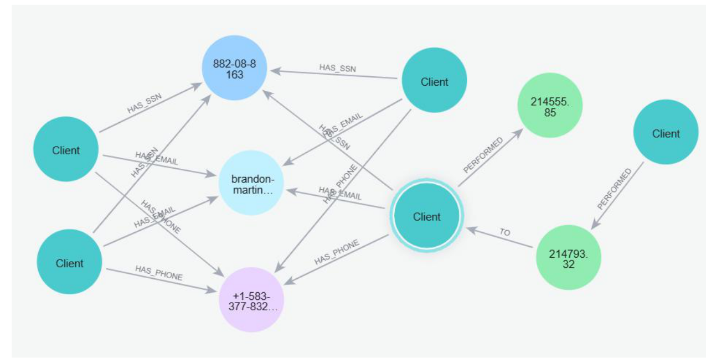
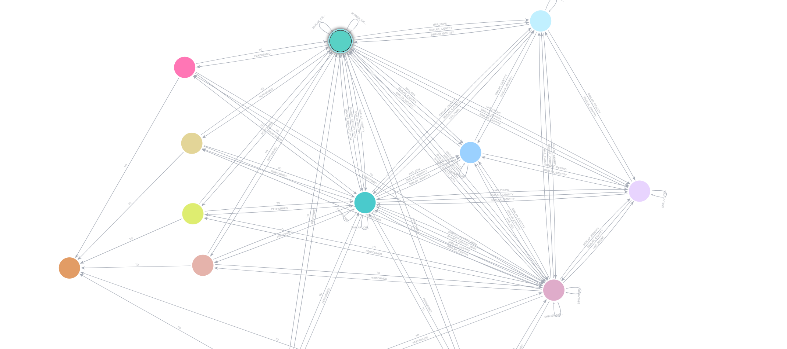

<h1 align="center">Knowledge Graph phát hiện gian lận Mobile Money</h1>
<p align="center"><b>Tìm đường dây gian lận bằng suy diễn đồ thị trên 258.213 giao dịch PaySim</b></p>

<p align="center">
  
  
  
  
  
</p>



<p align="center"><sub>Client ở giữa nối với 5 Client khác <b>hoàn toàn qua định danh dùng chung</b> — không qua một giao dịch trực tiếp nào. Dữ liệu định danh là giả, sinh bằng Faker.</sub></p>

---

## Ý tưởng

Gian lận mobile money hiện đại hiếm khi là hành vi đơn lẻ. Kẻ gian dựng một **mạng tài khoản trung gian (mule)** để rửa dòng tiền, và tái sử dụng một bộ giấy tờ để mở nhiều tài khoản giả.

Câu hỏi mà bộ phận rủi ro thực sự cần trả lời là:

> *"Hai tài khoản này có liên quan đến nhau không — dù chúng chưa từng giao dịch trực tiếp?"*

Trên cơ sở dữ liệu quan hệ, câu này đòi hỏi JOIN đệ quy nhiều tầng và chậm dần rất nhanh khi độ sâu tăng. Trên đồ thị, nó chỉ là một đường đi.

Đề tài mô hình hoá **tài khoản – giao dịch – định danh** thành một Knowledge Graph, rồi dùng suy diễn để **sinh ra quan hệ mới không hề có trong dữ liệu gốc** — đó là điểm phân biệt một Knowledge Graph với một graph database thuần.

## Mô hình đồ thị

```
Dữ liệu gốc:
  (:Client)-[:PERFORMED]->(:Transaction)-[:TO]->(:Client|:Merchant)
  (:Client)-[:HAS_SSN]->(:SSN)
  (:Client)-[:HAS_EMAIL]->(:Email)
  (:Client)-[:HAS_PHONE]->(:Phone)

Sinh ra bằng suy diễn:
  (:Client:SuspectedMule)                                 ← nhãn, từ luật hành vi
  (:Client)-[:SHARES_IDENTITY_WITH {via}]->(:Client)      ← entity resolution
  (:Client)-[:POSSIBLY_SAME_FRAUD_RING {confidence}]->(:Client)
  c.communityId, c.betweennessScore                       ← thuộc tính, từ thuật toán đồ thị
```

Thiết kế xuất phát từ **9 Competency Questions** chia ba tầng độ khó tăng dần: tra cứu trực tiếp (CQ1–CQ3) → multi-hop (CQ4–CQ6) → suy diễn thuật toán (CQ7–CQ9).

## Pipeline suy diễn 3 tầng

**Tầng 1 — luật hành vi.** Mule là tài khoản nhận TRANSFER rồi CASH_OUT gần như ngay sau đó, với số tiền gần bằng:

```cypher
MATCH (a:Account)-[:PERFORMED]->(t1:TRANSFER)-[:TO]->(mule:Client),
      (mule)-[:PERFORMED]->(t2:CASH_OUT)
WHERE t2.step - t1.step <= 1
  AND t2.amount >= 0.9 * t1.amount
SET mule:SuspectedMule;
```

**Tầng 2 — entity resolution.** Hai Client trỏ về cùng một node định danh thì nối trực tiếp với nhau, ghi lại nối qua đường nào:

```cypher
MATCH (c1:Client)-[:HAS_SSN|HAS_EMAIL|HAS_PHONE]->(shared)<-[:HAS_SSN|HAS_EMAIL|HAS_PHONE]-(c2:Client)
WHERE elementId(c1) < elementId(c2)
MERGE (c1)-[r:SHARES_IDENTITY_WITH]->(c2)
SET r.via = labels(shared)[0];
```

**Tầng 3 — thuật toán đồ thị** (Neo4j GDS): `gds.louvain` tìm cụm kết nối bất thường, `gds.nodeSimilarity` đo mức giống nhau về hàng xóm, `gds.betweenness` chỉ ra tài khoản giữ vai trò cầu nối trong cụm.

**Suy diễn bậc hai** — kết hợp cả ba tầng, kèm mức độ tin cậy:

```cypher
MATCH (a:Client)-[:SHARES_IDENTITY_WITH]-(b:Client)
WHERE a:SuspectedMule AND b:SuspectedMule
  AND a.communityId = b.communityId
MERGE (a)-[r:POSSIBLY_SAME_FRAUD_RING]->(b)
SET r.confidence = 'high';
```

Toàn bộ 9 CQ nằm trong [`cypher/02_inference_9CQ.cypher`](cypher/02_inference_9CQ.cypher).



<sub>Một lát cắt của đồ thị sau khi chạy xong cả ba tầng: phần lớn các cạnh trong hình là `SHARES_IDENTITY_WITH` — quan hệ **không có trong dữ liệu gốc**, do suy diễn sinh ra.</sub>

## Kết quả

Ground truth ở cấp tài khoản: một Client là gian lận nếu có liên quan (gửi hoặc nhận) tới ít nhất một giao dịch `isFraud = 1`.

| Phương pháp | Precision | Recall | F1 |
|---|---:|---:|---:|
| Chỉ luật hành vi (Suspected Mule) | 0,500 | **0,006%** | 0,0001 |
| Thêm Shared Identity | 0,042 | **100%** | 0,080 |
| Pipeline đa tầng đầy đủ | 0,042 | **100%** | 0,080 |

- Luật hành vi đơn thuần chỉ bắt được **2 tài khoản** trên toàn bộ 258.213 giao dịch. Chính xác khi nó bắt, nhưng bỏ sót gần như toàn bộ.
- Thêm tầng định danh đảo ngược hoàn toàn trade-off: Recall lên 100%, đổi lại Precision chỉ còn 4,2%.
- **Nói thẳng:** ở cấp tài khoản, pipeline đa tầng cho kết quả *bằng* Shared Identity, vì Shared Identity đã chạm trần Recall. Phần giá trị tăng thêm của việc kết hợp ba tầng nằm ở **cấp cặp tài khoản** và ở các ca cụ thể — xem ảnh đầu trang: những Client gian lận thật mà luật hành vi bỏ sót, chỉ lộ ra qua quan hệ gián tiếp.

Với bài toán sàng lọc rủi ro, đánh đổi này thường chấp nhận được: Recall cao để không bỏ lọt, rồi đẩy sang tầng rà soát thủ công. Nhưng Precision 4,2% nghĩa là cứ 100 cảnh báo thì khoảng 96 là báo động giả — chưa dùng trực tiếp để chặn giao dịch được.

<details>
<summary><b>Cách chạy lại</b></summary>

**1. Chuẩn bị dữ liệu.** Hai file trong [`data/`](data/) đã sẵn sàng dùng ngay. Nếu muốn sinh lại từ đầu:

```bash
pip install -r requirements.txt
# tải paysim.csv (6,3 triệu dòng) từ Kaggle, đặt cạnh notebook
jupyter notebook notebooks/01_prepare_and_load.ipynb
```
`SEED = 12345` nên kết quả tái lập đúng. Chi tiết schema và quy tắc tiêm định danh: [`data/README.md`](data/README.md).

**2. Cài Neo4j.** Neo4j Desktop + plugin **Graph Data Science**. Chép 2 file CSV vào thư mục `import` của database.

**3. Đặt mật khẩu qua biến môi trường** — notebook không hardcode:
```powershell
$env:NEO4J_PASSWORD = "..."     # PowerShell
```
```bash
export NEO4J_PASSWORD="..."     # macOS / Linux
```

**4. Chạy 4 file Cypher theo thứ tự** trong Neo4j Browser, mỗi khối một ô lệnh:

| File | Nội dung |
|---|---|
| [`01_load_pipeline.cypher`](cypher/01_load_pipeline.cypher) | constraint, nạp dữ liệu theo lô, validate |
| [`02_inference_9CQ.cypher`](cypher/02_inference_9CQ.cypher) | suy diễn 3 tầng, 9 Competency Questions |
| [`03_evaluation.cypher`](cypher/03_evaluation.cypher) | ground truth, confusion matrix, Precision/Recall/F1 |
| [`04_visualisation.cypher`](cypher/04_visualisation.cypher) | trích đồ thị để xuất ảnh |

**Hai cái bẫy đã gặp:**
- Neo4j Browser timeout ở 120 giây → phải **nạp theo lô 40.000–65.000 dòng**, không nạp một phát. Tổng thời gian nạp 15–30 phút tuỳ máy.
- Node Similarity trên đồ thị ~223.724 node / ~362.220 quan hệ mất khoảng 9,2 giây ghi kết quả.

</details>

## Hạn chế đã biết

1. **Dữ liệu định danh là mô phỏng có chủ đích**, sinh bằng Faker, không phải dữ liệu thật. Kết quả cần đọc trong bối cảnh đó và không suy rộng thẳng sang môi trường sản xuất.
2. **Birthday Paradox gây false positive** trong luật Shared Identity: có 3 tài khoản bình thường vô tình trùng SSN với nhau do Faker sinh lại, và bị gắn nhãn nhầm. Nếu dùng cho tập lớn hơn, cần kiểm tra tính duy nhất ngay khi sinh dữ liệu.
3. **Chưa có reasoner logic hình thức.** Các luật suy diễn viết bằng Cypher, chưa được OWL reasoner (HermiT/Pellet) kiểm chứng tính nhất quán.
4. **Nền thống kê mỏng.** Luật hành vi chỉ bắt được 2 tài khoản, quá ít để kết luận vững chắc; các ngưỡng (`step <= 1`, `amount >= 0.9`) đặt theo thực nghiệm, chưa tối ưu hoá có hệ thống.

**Hướng phát triển:** graph embedding (TransE, DistMult) hoặc GNN cho bài toán link prediction · dựng ontology OWL có reasoner · thay 2 mức `confidence` định tính bằng mô hình xác suất · chạy trên toàn bộ 6,3 triệu dòng PaySim để đánh giá khả năng mở rộng.

## Cấu trúc repo

```
knowledge-graph-fraud-neo4j/
├── notebooks/01_prepare_and_load.ipynb   lấy mẫu, sinh định danh, nạp Neo4j
├── cypher/                               4 file, chạy theo thứ tự đánh số
├── data/                                 2 file CSV + data dictionary
└── figures/
```

## Dữ liệu & giấy phép

Dữ liệu dẫn xuất từ **PaySim** (Lopez-Rojas, Elmir & Axelsson, 2016) — bộ mô phỏng, không phải giao dịch thật của khách hàng nào.

Repo dùng hai giấy phép:

| Phần | Giấy phép |
|---|---|
| `data/` | [CC BY-SA 4.0](https://creativecommons.org/licenses/by-sa/4.0/) — theo giấy phép của PaySim trên Kaggle |
| Code, notebook, tài liệu | [MIT](LICENSE) |

Nguồn, schema, quy tắc sinh dữ liệu và trích dẫn yêu cầu: [`data/README.md`](data/README.md).
